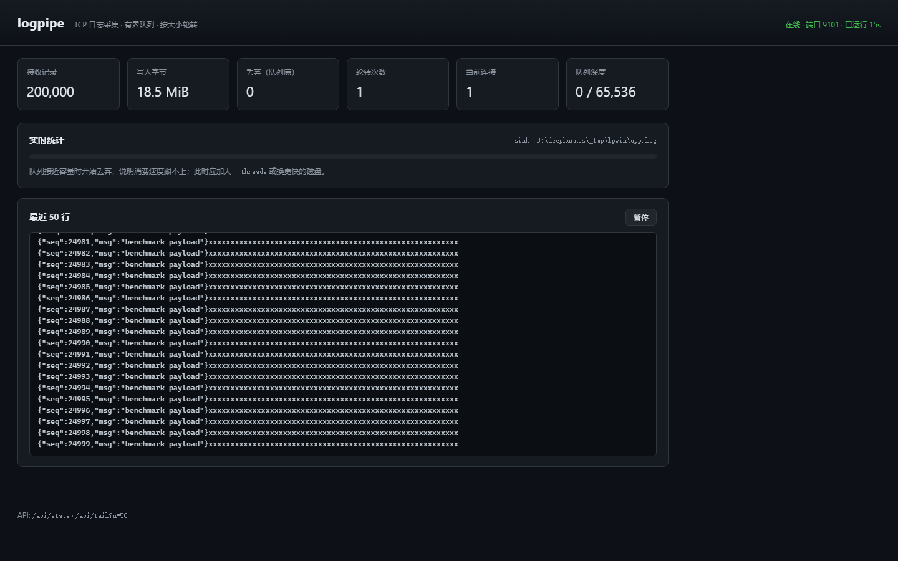

# logpipe

一个用 C++17 写的 TCP 日志采集器：多连接收日志 → 有界队列 → 线程池批量写盘（按大小轮转），
同一个端口还提供 `/api/stats`、`/api/tail` 和一个网页看板。

核心实现是跨 Linux / Windows 的反应堆接口、TCP 按行切分、有界队列和批量 I/O；附带压测客户端，便于观察吞吐、队列深度和丢弃量。

- 反应堆：Linux 用 `epoll`，Windows 用 `WSAPoll`（同一套接口，见 [server.cpp](src/server.cpp) 里的 `Reactor`）
- 写盘：有界队列 + 批量写 + 按大小轮转；队列满时**丢弃并计数**，绝不阻塞 I/O
- 协议：按行切分（处理 TCP 粘包 / 半包 / CRLF / 超长行），另有极简 HTTP 用于看板
- 测试：54 条断言，覆盖切包、轮转、查询参数边界、JSON 输出



## 目录

```
src/
  platform.h         socket 的平台差异（Windows / POSIX）
  server.h/.cpp      反应堆、连接状态机、限流与统计
  line_splitter.*    TCP 字节流 -> 完整行
  file_sink.*        线程安全的按大小轮转写盘
  http.*             请求行解析、查询参数、响应拼装
  metrics.*          原子计数器
  main.cpp           参数解析、信号处理、生命周期
tests/test_main.cpp  54 条断言
bench/bench.cpp      压测客户端（固定条数 / 固定时长两种模式）
web/                 看板（原生 JS，无构建步骤）
```

## 构建

依赖 CMake 和支持 C++17 的编译器。Linux（含 WSL2）使用 epoll；当前没有 macOS / kqueue 后端：

```bash
cmake -S . -B build -DCMAKE_BUILD_TYPE=Release
cmake --build build -j
ctest --test-dir build --output-on-failure
```

Windows 使用 WSAPoll；[CMakeLists.txt](CMakeLists.txt) 自动链接 `ws2_32`。以下命令选用 MinGW；MSVC 需要选择对应生成器和构建配置：

```powershell
cmake -S . -B build -G "MinGW Makefiles" -DCMAKE_BUILD_TYPE=Release
cmake --build build -j
.\build\logpipe_tests.exe
```

## 运行

```bash
./build/logpipe --port 9000 --out ./logs --rotate-mb 16 --keep 5 --threads 4
# 浏览器打开 http://127.0.0.1:9000/ 看实时看板
```

| 参数 | 默认 | 说明 |
| --- | --- | --- |
| `--host` | `0.0.0.0` | 监听地址 |
| `--port` | `9000` | 监听端口，`0` 表示由系统分配 |
| `--out` | `./logs` | 日志目录 |
| `--name` | `app.log` | 当前写入的文件名 |
| `--rotate-mb` | `16` | 写入下一批前检查文件大小阈值（MiB），不是严格文件大小上限 |
| `--keep` | `5` | 保留多少个历史文件（`app.log.1` …） |
| `--threads` | `2` | 写盘线程数 |
| `--queue` | `8192` | 队列容量，满了按丢弃处理并计数 |
| `--max-line` | `65536` | 单行最大字节数，超出整行丢弃 |
| `--web` | `./web` | 看板静态文件目录 |

发送日志（任何能往 TCP 写行的程序都行）：

```bash
printf 'hello\nworld\n' | nc 127.0.0.1 9000
```

## HTTP 接口

| 方法 | 路径 | 说明 |
| --- | --- | --- |
| GET | `/` | 看板页面（读 `--web` 目录） |
| GET | `/api/stats` | 计数、队列深度、当前文件、轮转次数、运行时长 |
| GET | `/api/tail?n=50` | 最近 n 行，`n` 会被夹到 `[1, 200]` |

```console
$ curl -s http://127.0.0.1:9000/api/stats
{"server":"logpipe","port":9000,"sink":"./logs/app.log","sink_bytes":225141462,"rotations":13,
 "uptime_ms":14518,"queue_depth":0,"queue_capacity":65536,
 "metrics":{"connections_accepted":9,"connections_closed":8,"bytes_in":225141549,"records":2321046,
 "written_bytes":225141462,"dropped":0,"rotations":0,"http_requests":1}}
```

## 历史压测记录

以下两组数字保留自原 README；仓库没有对应的原始运行日志，本次未重新压测。原记录未注明 CPU、磁盘、文件系统及页缓存状态，不能用于跨平台性能排名。

原记录环境：WSL2 Ubuntu 24.04，g++ 15.2 / cmake 4.2，`--threads 4 --queue 65536 --rotate-mb 16`，
压测客户端与服务器同机，8 条连接，每行 96 字节负载，目标持续 10 秒（记录总耗时 11.648 秒）：

```
lines sent       : 2,172,960 (x 96 bytes)
bytes sent       : 201.0 MiB
elapsed          : 11.648 s
throughput       : 186,560 lines/s, 17.3 MiB/s

服务端：records 2,172,960 / dropped 0 / 写入 210,777,120 字节 / 轮转 12 次 / 队列深度回落到 0
```

同一份代码在 Windows（MinGW-w64 14.2，静态链接，同机 loopback，8 连接各 25,000 行）上：

```
lines sent       : 200,000 (x 96 bytes)
elapsed          : 0.257 s
throughput       : 777,461 lines/s, 71.9 MiB/s

服务端：records 200,000 / dropped 0 / 写入 19,400,000 字节 / 轮转 1 次
```

几点说明，避免把数字读大：

- 这是**同机**压测，没有走真实网络；跨机吞吐还受网络带宽、延迟及客户端发送能力约束。
- 96 字节/行是偏小的日志行。行更大时按字节计的吞吐会更高，按条数计的吞吐会下降。
- 队列 65536 是刻意调大的：短时突发（比如 10 万行一次性灌入）先由队列吸收，写盘线程再慢慢排空，
  是否丢弃仍取决于瞬时生产/消费速率。持续过载会走到丢弃分支，这是设计选择：宁可丢日志，也不阻塞采集 I/O。
  丢弃数量在 `/api/stats` 里可见，方便告警。

## 设计上做过取舍的地方

1. **队列满就丢弃，不阻塞**：`dropped++` 然后返回，I/O 线程永远不做同步落盘。
2. **批量写**：写盘线程在累计达到 512 行或 256 KiB 时结束取批（最后一行可能使字节数越界），合并写入后调用 `flush`，提高实时读取可见性。
   原 README 记录早期逐行写版本在一次 10 万行突发中丢弃 27%；没有原始日志，未作为可复现对照结论。
   `ofstream::flush` 只刷新用户态缓冲，不等于 `fsync`，不能据此宣称断电持久化或物理磁盘吞吐。
3. **整行超长丢弃**：一条没有换行的坏数据不能把内存拖爆，超过 `--max-line` 就整段丢弃，
   并进入"丢弃到下一个换行"的状态，保证后续行还能正常解析。
4. **轮转按批检查**：已有文件非空、且加上下一批会超过阈值时先轮转，再整批写入；单批本身可超过阈值，所以文件大小不是硬上限。
5. **看板不引前端框架**：两三个接口、一张表格，原生 JS 足够，也不需要 node_modules。

## 测试核对

[tests/test_main.cpp](tests/test_main.cpp) 包含 54 条断言。2026-11-15 在 Windows 11 执行工作区已有的 `build_win/logpipe_tests.exe`，输出 `54 checks, 0 failures`。该二进制未在本次重新编译，不能替代当前源码的干净构建验证；构建与 CTest 命令见上文。

## 已知限制

- HTTP 只支持 `Connection: close`，没有 keep-alive；看板每 2 秒一个新连接，够用但不优雅。
- 没有 TLS，也没有鉴权。默认监听 `0.0.0.0`，并不自动限定内网；本机试用建议加 `--host 127.0.0.1`，部署时用防火墙或隔离网络限制访问。
- 轮转按文件大小，不按时间；`app.log.N` 的编号在进程重启后会从 1 重新开始覆盖。
- 写入失败（磁盘满、权限）目前只返回 false，不会重试也不会告警，只在下次写入时继续尝试。
